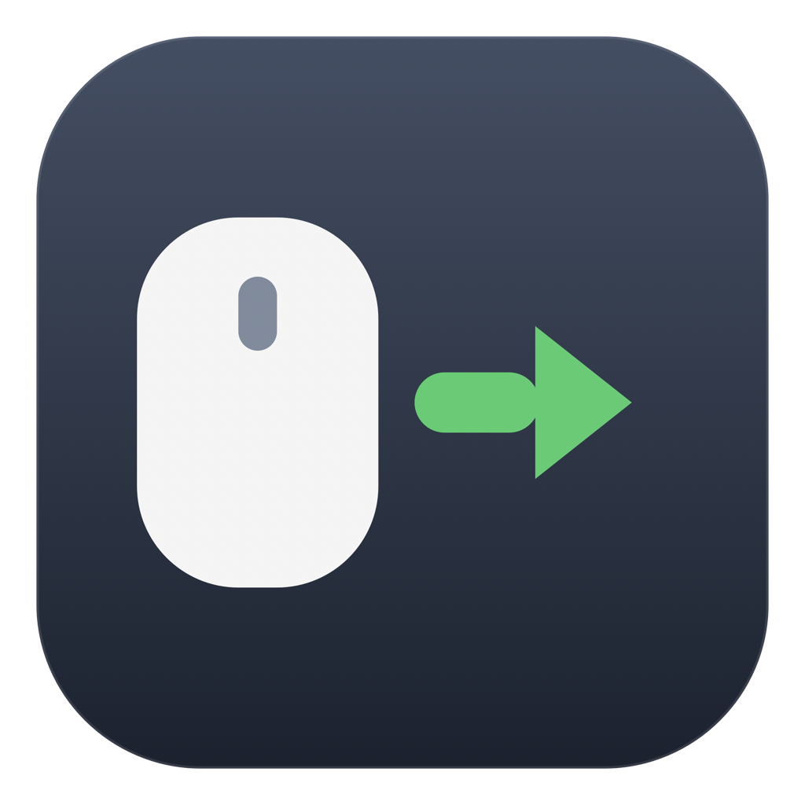

# PPT 翻页笔（PPT Clicker）

[](https://github.com/tncki/ppt-clicker/actions/workflows/ci.yml)
[](https://github.com/tncki/ppt-clicker/releases)
[](https://github.com/tncki/ppt-clicker)
[](LICENSE)

**把任意鼠标变成翻页笔。**

不用接收器、不用额外硬件、不用厂商驱动。放映 PPT 时，让普通鼠标变成演示遥控器；不放映时它完全不打扰你。



```
左键        → 下一页（发送 →）
滚轮向下滚  → 下一页（发送 →）
右键        → 上一页（发送 ←）
滚轮向上滚  → 上一页（发送 ←）
```

支持 **Keynote、Microsoft PowerPoint、WPS Office、LibreOffice Impress、预览、Adobe Acrobat**，以及任何响应方向键的放映器 —— 包括 Google Slides 这类网页版演示。

---

## 特点

| | |
| --- | --- |
| **任意鼠标** | 蓝牙、2.4G、USB、触摸板按键都行：只要 macOS 能收到点击，就能重映射 |
| **四种开关方式** | 全局快捷键（默认 `⌃⌥⌘P`）、双击滚轮键、`ESC`、点角落指示灯 |
| **角落指示灯** | 一颗常驻最上层的小圆点：绿点 = 正在拦截，灰圈 = 空闲。点击开关，拖动换位置 |
| **想改哪个键就改哪个** | 左/右/中键、侧键、滚轮上下左右 → 下一页、上一页、Page Up/Down、空格、Esc、黑屏、白屏、吞掉、或放行 |
| **滚轮方向自动适配** | 跟随系统「自然滚动」设置，所以任何机器上"向下滚"都是下一页 |
| **不碰隐私** | 不联网、不上报、不记录键盘。事件监听默认只订阅鼠标；只有你开启「ESC 关闭」时才额外旁听 ESC 一个键 |
| **零依赖** | 纯 Swift + AppKit，约 1500 行，不需要包管理器，也没有 Xcode 工程文件 |

## 安装

三种方式。**前两种完全不弹 Gatekeeper** —— 因为脚本用 `curl` 下载，而只有浏览器下载才会被标记「隔离」属性（未公证的 App 被标记后才会被系统拦截）。

### Homebrew（推荐）

```bash
brew tap tncki/ppt-clicker https://github.com/tncki/ppt-clicker
brew install --cask ppt-clicker
```

### 一行命令安装

```bash
curl -fsSL https://raw.githubusercontent.com/tncki/ppt-clicker/main/install.sh | bash
```

脚本会：取最新 Release → 用 `SHA256SUMS.txt` 校验完整性 → 装到 `/Applications`（不可写则退到 `~/Applications`）→ 启动。**无需要手动放行。**

### 手动下载

从 [Releases](https://github.com/tncki/ppt-clicker/releases) 下载 `PPT-Clicker-<版本>.zip` 或 `.dmg`，解压后把 **PPTClicker.app** 拖进 `/Applications`。浏览器下载会被标记为「隔离」，首次打开会被拦，执行一次即可：

```bash
xattr -dr com.apple.quarantine "/Applications/PPTClicker.app"
```

（也可以先尝试打开，再到 系统设置 → 隐私与安全性 → **仍要打开**。注意 macOS 15 起已经取消了旧的"右键→打开"绕过方式。）

> **为什么不做公证？** 公证需要 Apple 开发者账号（$99/年），本项目刻意不使用。App 用临时签名，上面两条安装路径完全绕开这个提示。

### 授予权限

| 权限 | 用途 | 是否必需 |
| --- | --- | --- |
| **辅助功能** | 拦截并替换鼠标事件 | **必需** |
| **输入监控** | 只读旁听 `ESC` 键 | 只有想要「ESC 关闭」才需要 |

系统设置 → 隐私与安全性 → 辅助功能 / 输入监控 → 打开 **PPT Clicker**。首次启动时程序会自动帮你打开对应设置页，菜单里也能随时看到权限状态。

> 重新编译后授权会失效（macOS 把权限绑在二进制的签名指纹上），需要重新打开一次开关。

## 使用

1. 开始放映。
2. 开启：**双击鼠标滚轮键**（或按 `⌃⌥⌘P`）—— 角落小圆点变**绿**即已开启。
3. 左键 / 滚轮向下 = 下一页；右键 / 滚轮向上 = 上一页。
4. 关闭：按 `ESC`、再双击滚轮键、再按一次 `⌃⌥⌘P`、或点一下小圆点。

小圆点默认在**屏幕右上角、菜单栏正下方**。可以拖到任意位置（会记住）；右键它=完整菜单。菜单栏里也有一个同款菜单入口。

> 默认是**全局生效**：绿点亮着时，所有软件里的点击/滚轮都会被替换，而不只是放映软件。这样最可预期（网页版演示也能用）。如果你想只在演示软件里生效，勾选菜单里的「仅在前台是演示软件时生效」，或把配置里 `scope` 改成 `"apps"`。

## 配置

```
~/Library/Application Support/PPTClicker/config.json
```

菜单 →「打开配置文件…」编辑，改完点「重新载入配置」。带完整注释的样例见 [`config.example.json`](config.example.json)。

### 可绑定的事件

`leftClick`、`rightClick`、`middleClick`、`backButton`、`forwardButton`、`scrollUp`、`scrollDown`、`scrollLeft`、`scrollRight`

### 可用的动作

| 值 | 含义 |
| --- | --- |
| `next` / `prev` | 发送 `→` / `←` |
| `pageDown` / `pageUp` | 发送 Page Down / Page Up |
| `space` / `escape` | 发送空格 / Esc |
| `black` / `white` | Keynote 黑屏 / 白屏（`b` / `w`） |
| `none` | 拦截事件但什么都不做 |
| `pass` | 不拦截，保持系统原本行为 |

### 其它字段

| 字段 | 默认 | 说明 |
| --- | --- | --- |
| `hotkey` | `⌃⌥⌘P` | `key` 支持 a–z、0–9、f1–f12、space、escape、方向键等；`modifiers` 支持 `control`/`option`/`shift`/`command`（至少留一个） |
| `escapeDisables` | `true` | 按 ESC 也关闭（只旁听，放映仍可用 ESC 退出） |
| `middleDoubleClickToggles` | `true` | 双击滚轮键切换 |
| `showIndicator` | `true` | 显示角落指示灯 |
| `scrollDirection` | `auto` | `auto` 跟随系统「自然滚动」；也可强制 `normal` / `inverted` |
| `throttleMs` | `300` | 两次滚轮翻页的最小间隔 |
| `scope` | `global` | `global` 所有软件；`apps` 仅前台应用在白名单里时 |
| `apps` | Keynote / PowerPoint / WPS / Impress / 预览 / Acrobat / Chrome / Safari / Edge | `scope: apps` 用的白名单 |
| `startEnabled` | `false` | 启动时是否直接开启 |
| `debugLog` / `logPath` | `true` / `~/Library/Logs/PPTClicker.log` | 生命周期日志 |
| `debugEvents` | `false` | 记录每一个原始鼠标事件与每次拦截（排查问题用） |

查某个 App 的 bundleID：`osascript -e 'id of app "Microsoft PowerPoint"'`

## 常见问题

**双击滚轮后还是灰点。** 缺辅助功能权限。菜单里看「辅助功能权限」那一行。

**ESC 关不掉。** 需要在「输入监控」里授权，然后重启程序。

**绿点亮着但 PPT 不翻页。** 绿点只表示"正在拦截"，方向键还得送到放映窗口——确认放映窗口是前台。打开 `"debugEvents": true` 看 `~/Library/Logs/PPTClicker.log`：正常时每次点击都会记一条 `左键 → next（keyCode 124）`。

**滚轮方向反了。** 把 `scrollDirection` 改成 `inverted`（或 `normal`），重新载入配置。

**滚一下翻好几页。** 调大 `throttleMs`（如 `500`）。

**找不到小圆点。** 可能被拖到屏幕外了（比如拔掉过显示器），或者被菜单里「显示屏幕角落的指示灯」关掉了；重新勾选就会回到角落。

**放映时点不动幻灯片里的链接。** 左键被换成了 `→`。把 `leftClick` 改成 `pass`，只用滚轮翻页。

**卸载。** 菜单 →「退出」；开过开机自启就先取消勾选；删掉 App；再删 `~/Library/Application Support/PPTClicker` 和日志；最后在辅助功能/输入监控里移除条目。

## 实现原理

```
Sources/
  main.swift         入口 + 隐藏命令行开关（--selftest、--print-default-config …）
  AppDelegate.swift  菜单栏、权限、指示灯、配置重载、开机自启
  EventTap.swift     挂在 HID 层的 CGEventTap：拦截、吞事件、合成按键
  Mapping.swift      纯逻辑：动作、键码、滚轮方向解析（有单元测试）
  Config.swift       宽容解析的 JSON 配置 + 默认模板
  Indicator.swift    角落指示灯（无边框置顶面板）
  Localization.swift 极简中英文字符串表
  Log.swift          文件日志
  SelfTest.swift     89 项无界面断言
```

- 事件监听插在 **HID 事件流的头部**，先于任何 App（包括放映软件）收到鼠标事件；命中映射就吞掉原事件，再合成方向键回注到 HID 流。
- 自己合成的按键带 `eventSourceUserData` 标记，避免被自己的监听再次处理（否则会自我循环）。
- 惯性/连续滚动只吞不触发；连发用节流合并；方向一变立即放行，所以能快速来回翻。
- 双击滚轮键有冷却期，连按不会反复切换。
- 全局快捷键用系统 `RegisterEventHotKey`，**完全不需要权限**；只有它注册失败时才退回事件监听兜底。
- 启动时会合成一次带标记的点击落在地标上，检查自己的监听能不能收到——整条拦截链路的自检，不需要人工参与。
- 菜单栏点击、打开的菜单本身、系统设置窗口一律放行，保证程序自己的界面永远点得动。

## 开发

需要 macOS 13+ 与 Xcode Command Line Tools（或 Xcode）。

```bash
git clone https://github.com/tncki/ppt-clicker.git
cd ppt-clicker
./build.sh                 # 本机架构 + 跑自测
./build.sh --universal     # arm64 + x86_64 通用二进制
./release.sh               # 通用二进制 + zip + dmg + SHA256SUMS.txt
```

`./build.sh` 会跑 89 项断言（动作、键码、滚轮方向、节流、双击检测、配置解析）。CI 每次 push 都会跑同样的命令。

## 已知限制

- **只映射鼠标**。放映中途改用触摸板的话，两指滑动会按 `scrollUp`/`scrollDown` 处理。
- `escape` 这个**动作**无法退出 Keynote 放映（用你自己的 ESC 键即可——程序不会拦它）。
- 左键被换成 `→` 后，**幻灯片里的链接和按钮点不动**；需要就把它绑成 `pass`。
- 指示灯占据屏幕角落 16×16 点的区域，那一小块内的点击会落到圆点上（可拖走或隐藏）。
- 没有公证（刻意不使用付费 Apple 账号）。用 Homebrew 或一行脚本安装不会弹提示；
  浏览器下载则需执行一次上面的 `xattr` 命令。
- 移动 App 目录会导致辅助功能授权与开机自启失效。

## 许可证

[MIT](LICENSE)
